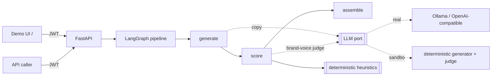
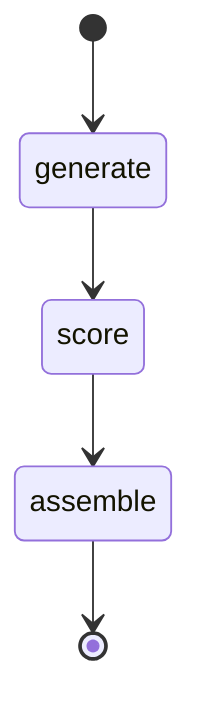

<!-- GitHub topics: fastapi, langgraph, marketing-automation, llm, campaign-generation, python, prometheus, jwt, evaluation -->

# Lifecycle Campaign Studio

[](https://github.com/Sairajiv-13/campaign-studio/actions/workflows/ci.yml)
[](https://www.python.org/)
[](https://opensource.org/licenses/MIT)

> Generates email/SMS campaign variants per audience segment, scores each one, and
> tells you which to send. The scoring is measured against human judgment, not
> assumed.

I wanted to see how far you can get grading marketing copy automatically. Writing
the copy is the easy half. Any model will hand you five subject lines. Picking
which one actually goes out is the part most "AI marketing" demos skip, usually by
asking the model to grade its own homework.

So the generation here is deliberately unremarkable. The scoring is the point.

Give it a product brief and some segments, and it writes variants for each segment,
scores every one on brand voice, clarity, CTA strength, personalization, and
deliverability, then ranks them and hands back a winner plus a runner-up for A/B.

It runs with no API key and no model download. The generator and the brand-voice
judge both have deterministic sandbox implementations, so CI is hermetic and the
demo works offline. Point it at a real model with one env var when you want to.

**Run it:** `docker compose up --build` → http://localhost:8000 → sign in with
`marketer` / `local-dev-password`

---

## What's real, what isn't

Stated up front, because it's the thing most portfolio READMEs get wrong
([ADR-009](docs/adr/009-honest-documentation.md)):

- **Real and runnable here:** the pipeline, the scorer and its 18-pair validation,
  cost accounting, the budget breaker, brief-fingerprint caching, the brand-safety
  guardrail, the prompt-injection and XSS fixes, and the test suite (77 passing,
  94% coverage). Every number in this README comes from running one of those.
- **Built but unverified at scale:** this has **never been deployed or run at real
  traffic.** The Grafana dashboard is a correct definition whose panels stay empty
  until something scrapes a live instance.
- **Costs are estimates at published per-token rates**, computed locally and reset on
  restart. A guardrail signal, not a reconciled bill. `/v1/usage` says so in its own
  response.
- **Real-model validation was attempted and blocked by hardware.** The attempt and
  repro steps are in [docs/EVALUATION.md](docs/EVALUATION.md) rather than quietly
  replaced with sandbox numbers dressed up as model quality.

No invented metrics, incidents, or screenshots. If a number isn't reproducible from
this repo, it says so.

---

## What makes it more than "call an LLM"

Generation is the boring half. The real question is which variant ships, and
"ask the model which one it likes" is circular. Same student grading the exam.

So most of the scorer is plain Python:

| Dimension | How it's measured |
|-----------|-------------------|
| **brand_voice** | LLM-as-judge against the brand tone, plus a hard banned-phrase check in code |
| **clarity** | Flesch reading ease, plus subject-line length rules for email |
| **cta_strength** | strong vs weak call-to-action detection |
| **personalization** | merge tags, segment-trait references, second person |
| **deliverability** | spam triggers, shouting caps, exclamation abuse |

Those roll into a weighted composite. Brand voice and CTA carry the most weight;
deliverability is a floor you shouldn't sink through. Great copy in the spam
folder is worth nothing.

I do use an LLM as the judge for brand voice, because tone is genuinely hard to
pin down with rules. But I don't trust it on its own. Banned phrases are checked
in code, not by the model, and if the judge is unreachable the score falls back to
that check instead of failing the request.

The obvious follow-up is "how do you know the scorer is any good?" So there's an
eval: 18 hand-labeled A/B pairs where the label is the variant a marketer would
actually send. The winning side alternates, so a positionally-biased scorer scores
~50% instead of looking accidentally good. `make eval` reports pairwise ranking
accuracy and CI fails below the threshold.

**It scores 88.9% — 16 of 18.** The two it misses are in the set on purpose.

Twelve of the pairs each isolate one lever the scorer measures, so it sweeps them;
that's a regression test, not a benchmark. The other six are adversarial: the copy
a marketer would pick *loses* on a measured dimension. Two of those break it:

- It prefers copy that cites your exact browsing times over a clean alternative.
  Maximum personalization score, maximum creepiness. The heuristic counts signals
  and has no concept of *appropriate*.
- It can't tell "You won't believe what happened" from "Your account has 3 new
  features". Both are well-formed; only one says anything. The rubric measures the
  shape of copy, not whether it has content.

Both are pinned by a test, so if either starts passing I'll know the scorer
actually improved instead of finding out by accident. Full write-up, including a
pass that succeeds for the wrong reason, is in [docs/EVALUATION.md](docs/EVALUATION.md).

Eighteen pairs labeled by one person isn't proof the scorer is right. It's enough
to catch a regression and to know two specific things it gets wrong.

## The parts that aren't the demo

Generating copy is one API call. These are the things that make it a system you
could actually put in front of a marketing team. Each one a real mechanism with a
test and an ADR:

- **It tells you what the campaign cost.** Every LLM call is priced into a
  per-request ledger, so a plan reports its own generation cost. A daily budget
  breaker degrades to the sandbox model before a runaway bill happens, and
  `GET /v1/usage` shows spend against the cap.
  [ADR-004](docs/adr/004-cost-tracking.md)
- **One bad completion doesn't sink the campaign.** A malformed response degrades
  that one segment × channel slot to a template; the plan reports `degraded` and a
  `fallback_count` rather than silently shipping worse copy.
  [ADR-005](docs/adr/005-generation-resilience.md)
- **It won't pay twice for the same brief.** Briefs are fingerprinted, and the
  fingerprint includes the model label, so sandbox output never gets served as if a
  real model produced it. An identical brief returns the cached plan.
  [ADR-006](docs/adr/006-brief-idempotency.md)
- **Brand-safety is deterministic, and it outranks the score.** SMS length, unknown
  merge tags, and banned phrases are *hard* flags: a variant carrying one can't win
  its segment no matter how well it scores. Spam triggers and shouting are advisory.
  [ADR-007](docs/adr/007-brand-safety-guardrails.md)
- **A hostile brief can't rewrite the prompt or run script in the UI.** Both were
  real bugs, found and fixed: user values are flattened so they can't forge a
  `label: value` line, and model-produced notes are escaped before rendering.
  [ADR-010](docs/adr/010-prompt-injection-and-output-escaping.md) ·
  [SECURITY.md](docs/SECURITY.md)

Operating it: [OPERATIONS.md](docs/OPERATIONS.md) ·
[TROUBLESHOOTING.md](docs/TROUBLESHOOTING.md) ·
[OBSERVABILITY.md](docs/OBSERVABILITY.md).

## Architecture



## Pipeline



- **generate**. For each segment × channel, ask the model for N on-brand variants
  as JSON. A malformed completion falls back to a templated variant, so one bad
  response doesn't sink the whole campaign.
- **score**. Grade every variant with the heuristics plus the brand-voice judge
  into a `ScoreBreakdown`.
- **assemble** — rank per segment, pick the winner and runner-up, roll up into a
  `CampaignPlan`.

Each node is a pure `async (state, ctx) -> dict` that returns only what it changed,
so they're unit-tested in isolation against the sandbox model. Design notes are in
[docs/adr/](docs/adr/).

## Quickstart

```bash
cp .env.example .env                 # defaults are sandbox-safe, no secrets
docker compose up --build            # studio on http://localhost:8000
```

Open `http://localhost:8000/`, sign in with `marketer` / `local-dev-password`,
pick segments, generate. Without Docker:

```bash
uv venv --python 3.12 && uv pip install -e ".[dev]"   # or plain pip
make run          # http://localhost:8000
```

### API

```bash
TOKEN=$(curl -s -X POST localhost:8000/v1/auth/token -H 'Content-Type: application/json' \
  -d '{"account_id":"marketer","password":"local-dev-password"}' | jq -r .access_token)

curl -s -X POST localhost:8000/v1/campaigns -H "Authorization: Bearer $TOKEN" \
  -H 'Content-Type: application/json' -d '{
    "brief": {
      "product_name": "Aurora",
      "product_description": "sleep and focus supplements",
      "value_props": ["fall asleep faster", "no grogginess"],
      "brand_voice": {"tone": "friendly", "banned_phrases": ["miracle cure"]},
      "goal": "abandoned_cart",
      "channels": ["email", "sms"],
      "segments": [
        {"id": "cart", "name": "Cart abandoners", "traits": ["added to cart"], "incentive": "10% off"}
      ],
      "variants_per_segment": 3
    }
  }'
```

| Method & path | Auth | Purpose |
|---------------|------|---------|
| `GET /` | public | Demo UI |
| `GET /health` | public | Liveness + model + campaign count |
| `GET /metrics` | public | Prometheus metrics (LLM calls/latency, cost by model, cost per campaign, budget trips, cache hits, fallbacks, guardrail flags by rule) |
| `POST /v1/auth/token` | service creds | Exchange credentials for a JWT |
| `POST /v1/campaigns` | `campaigns:write` | Generate + score a campaign |
| `GET /v1/campaigns/{id}` | `campaigns:read` | Fetch a stored plan |
| `GET /v1/usage` | `campaigns:read` | Today's estimated spend, the budget cap, and whether generation is degraded |

## Using a real model

Set `LLM_MODE=real` and point `LLM_BASE_URL` at any OpenAI-compatible endpoint
(local Ollama by default. `ollama pull llama3.1`). Same code path: the prompts
already ask for JSON via `response_format`. Transient failures (timeouts, 5xx,
429) retry three times with 1s/2s backoff; 4xx and malformed responses fail fast,
since retrying those just burns quota.

The sandbox exists so the repo runs with nothing installed, not because the real
path is an afterthought.

## Evaluation

```bash
make eval        # python -m evals --min-accuracy 0.8
```

Reports pairwise ranking accuracy against the labeled pairs, broken down by lever,
and exits non-zero below the threshold so CI catches a scoring regression.

## Testing

Hermetic. Sandbox model, in-memory store, no services, no secrets.

```bash
make test        # or: make cov  (>80% gate)
make lint type   # ruff + mypy strict
```

## Project layout

```
app/
  domain/     Brief, Segment, Variant, ScoreBreakdown, CampaignPlan
  llm/        LLM port + real (OpenAI-compatible) and sandbox generator/judge
  scoring/    deterministic heuristics + composite scorer (LLM-as-judge)
  graph/      LangGraph nodes (generate, score, assemble) + compiled pipeline
  security/   JWT, scopes, in-process rate limiting
  api/        FastAPI routes + schemas
  web/        self-contained demo UI
  cost.py     per-request LLM cost ledger + budget tracker
  guardrails.py  deterministic brand-safety / compliance rules
  idempotency.py brief fingerprinting (don't pay twice)
  prompting.py   safe `label: value` prompt assembly
evals/        labeled A/B dataset + ranking-accuracy harness (CI gate)
ops/          Prometheus config + Grafana dashboard/provisioning
docs/         ADRs (001-010) · OPERATIONS · TROUBLESHOOTING · SECURITY · OBSERVABILITY · EVALUATION · DEPLOYMENT
tests/        unit + integration (hermetic)
```

Deployment notes and the full env var table are in
[docs/DEPLOYMENT.md](docs/DEPLOYMENT.md).

## What I'd do next

Roughly in the order I'd actually pick them up:

1. **Predicted engagement model**. The biggest gap. Right now engagement is a
   heuristic proxy; a small model trained on historical open/click data per segment
   would replace guesswork with evidence.
2. **Send-time optimization**. Picking when to send, and which channel, per
   segment. Cheap to add, measurable lift.
3. **Multivariate testing**. Real experiment tracking so the A/B winner is
   validated against actual results instead of just the scorer's opinion.
4. **Persistence and history**. Swap the in-memory store for Postgres behind the
   existing interface, plus per-brand voice profiles. This is also what unblocks a
   durable spend counter and an audit trail; today both reset with the process.
5. **Claims and regulated-copy checks** — the guardrail covers mechanical and
   brand rules (length, merge tags, banned phrases, spam signals). It does *not*
   check whether a claim is substantiated, which is what health and finance copy
   actually needs.
6. **Streaming generation**. Mostly a UX win; the wait is noticeable with a real
   model.

---

Built by [Sai Rajiv Nagula](https://github.com/Sairajiv-13). MIT licensed.
