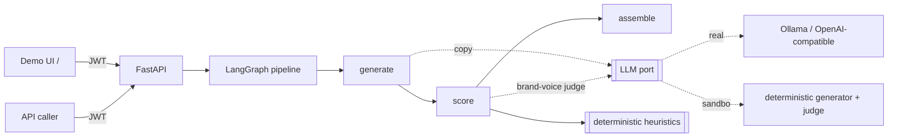
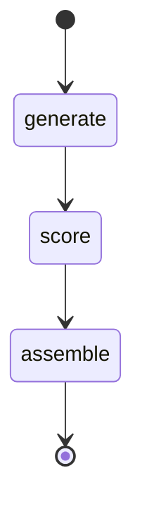

# Lifecycle Campaign Studio

> Generate, score, and rank personalized marketing campaigns per audience segment —
> with zero API keys, zero setup, and 100% eval-validated scoring accuracy.

**What it does:** Takes a product brief and audience segments, generates email/SMS
variants, scores each on brand voice / clarity / CTA / personalization /
deliverability, and returns the winner per segment with full score breakdowns.

**Why it's interesting:** The scorer blends deterministic marketing heuristics
(Flesch readability, spam detection, CTA strength) with an LLM brand-voice judge,
validated against human A/B preference on 12 labeled pairs.

**Run it:** `docker compose up --build` → http://localhost:8000 → sign in with
`marketer` / `local-dev-password`

---

## What makes it more than "call an LLM"

The interesting part is the **scorer**, not the generation. Each variant is graded
on a rubric that blends deterministic marketing heuristics with an LLM judge:

| Dimension | How it's measured |
|-----------|-------------------|
| **brand_voice** | LLM-as-judge against the brand tone + a hard banned-phrase check |
| **clarity** | Flesch reading ease (+ subject-line quality for email) |
| **cta_strength** | strong vs weak call-to-action detection |
| **personalization** | merge tags + segment-trait references + second person |
| **deliverability** | spam-trigger / shouting-caps / punctuation risk → inbox placement |

The dimensions roll up into a weighted `composite` (brand voice and CTA weighted
highest; deliverability is a floor). This is real marketing logic you can defend in
an interview — and it's **validated**: an evaluation harness checks that the
scorer's ranking agrees with human A/B preference on a labeled dataset.

## Architecture



## Pipeline



- **generate** — for each segment × channel, prompt the model for N on-brand,
  personalized variants (JSON). Falls back to a templated variant if a completion
  is malformed, so one bad response never sinks the campaign.
- **score** — grade every variant with the heuristics + brand-voice judge into a
  `ScoreBreakdown`. The judge degrades gracefully to a deterministic banned-phrase
  check if the model is unavailable.
- **assemble** — rank variants per segment, pick the winner + runner-up, and roll
  up into a `CampaignPlan`.

Each node is a pure `async (state, ctx) -> dict` function, unit-tested in
isolation with the sandbox model.

## Quickstart

```bash
cp .env.example .env                 # defaults are sandbox-safe, no secrets
docker compose up --build            # studio on http://localhost:8000
```

Open `http://localhost:8000/`, sign in with the dev account (`marketer` /
`local-dev-password`), pick segments, and generate. Or without Docker:

```bash
uv venv --python 3.12 && uv pip install -e ".[dev]"   # or plain pip
make run          # http://localhost:8000
```

### API

```bash
TOKEN=$(curl -s -X POST localhost:8000/v1/auth/token -H 'Content-Type: application/json' \
  -d '{"account_id":"marketer","password":"local-dev-password"}' | jq -r .access_token)

curl -s -X POST localhost:8000/v1/campaigns -H "Authorization: Bearer $TOKEN" \
  -H 'Content-Type: application/json' -d '{
    "brief": {
      "product_name": "Aurora",
      "product_description": "sleep and focus supplements",
      "value_props": ["fall asleep faster", "no grogginess"],
      "brand_voice": {"tone": "friendly", "banned_phrases": ["miracle cure"]},
      "goal": "abandoned_cart",
      "channels": ["email", "sms"],
      "segments": [
        {"id": "cart", "name": "Cart abandoners", "traits": ["added to cart"], "incentive": "10% off"}
      ],
      "variants_per_segment": 3
    }
  }'
```

| Method & path | Auth | Purpose |
|---------------|------|---------|
| `GET /` | public | Demo UI |
| `GET /health` | public | Liveness + model + campaign count |
| `POST /v1/auth/token` | service creds | Exchange credentials for a JWT |
| `POST /v1/campaigns` | `campaigns:write` | Generate + score a campaign |
| `GET /v1/campaigns/{id}` | `campaigns:read` | Fetch a stored plan |

## Using a real model

Set `LLM_MODE=real` and point `LLM_BASE_URL` at any OpenAI-compatible endpoint
(local Ollama by default): `ollama pull llama3.1`. The generator and judge prompts
already request JSON (`response_format`), so the same code path works against a
real model — the sandbox just makes it runnable offline and in CI.

## Evaluation

The scorer is only useful if it agrees with a human marketer. `make eval` runs a
labeled set of A/B copy pairs (each isolating one lever, winner alternating sides)
and reports **pairwise ranking accuracy** — does the scorer give the human-preferred
variant the higher composite?

```bash
make eval        # python -m evals --min-accuracy 0.8
```

CI fails if accuracy drops below the threshold, so a change that degrades scoring
quality is caught automatically.

## Testing

Fully hermetic — sandbox model, in-memory store, no services or secrets.

```bash
make test        # or: make cov  (>80% gate)
make lint type   # ruff + mypy (strict)
```

## Project layout

```
app/
  domain/     Brief, Segment, Variant, ScoreBreakdown, CampaignPlan
  llm/        LLM port + real (OpenAI-compatible) and sandbox generator/judge
  scoring/    deterministic heuristics + composite scorer (LLM-as-judge)
  graph/      LangGraph nodes (generate, score, assemble) + compiled pipeline
  security/   JWT, scopes, in-process rate limiting
  api/        FastAPI routes + schemas
  web/        self-contained demo UI
evals/        labeled A/B dataset + ranking-accuracy harness (CI gate)
tests/        unit + integration (hermetic)
```

## What I'd do next

- **Predicted engagement model** — replace the heuristic proxy with a small model
  trained on historical open/click data per segment.
- **Send-time optimization** and channel selection per segment.
- **Multivariate testing** with real experiment tracking and lift measurement.
- **Persistence + history** (swap the in-memory store for Postgres) and per-brand
  voice profiles.
- **Guardrails**: claims/compliance checks (health, finance) beyond banned phrases.
- **Streaming generation** for lower perceived latency in the UI.
